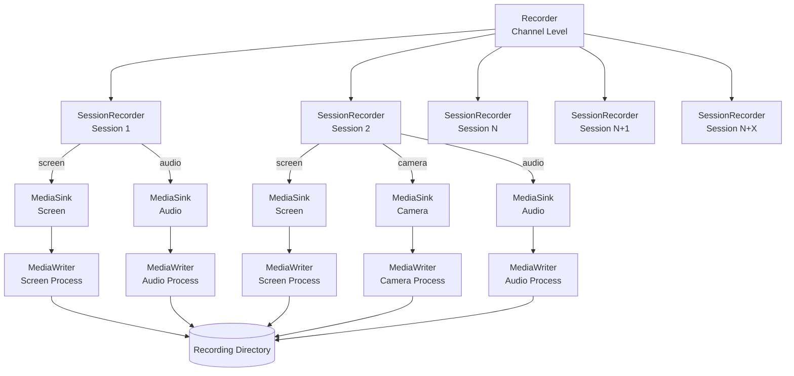

# Recording

see [recording/\*](../src/recording) for more details.

The SFU can record streams from a channel (depending on permissions and SFU setup).

Recording happens in two steps:

1. each streams is recorded in real time individually (the "raw recording").
2. later, the raw recordings are processed to produce one "combination" file.

The two phase approach allow for the real time part to be light (only writing packets to file, no transcoding), and then the compiling phase (composition/mixing and transcoding) can be done later with no real time constraint (so the heavy work can be done when the SFU is not under too much load).

Recording state contains the active `audio`, `video` and `transcription`
outputs. A recording is active when at least one output is active. Audio and
video remain fixed for the recording. Transcription may change while audio or
video remains active. `setRecording` preserves omitted flags and stops the
recording when the resulting output set is empty.

Starting requires at least two participants. A solo start returns `false` without
allocating recording resources. Recording stops with `channel_closed` when a
participant leaves one person behind.

## Architecture



### Components

1.  **Recorder (Channel Level)**
    Manages recording for an entire `Channel`.
    Handles the lifecycle of recording and holds the `SessionRecorder`s for current sessions and listens for new sessions joining the channel to create them dynamically.

2.  **SessionRecorder (Session Level)**
    Bound to a specific rtc `Session`.
    Monitors the user's producers (audio, camera, screen). When a user releases a stream (e.g., turns on camera), the `SessionRecorder` detects it and manages a `MediaSink` for each.

    -   **Inputs:** `audio`, `camera`, `screen` flags determine which streams to record.

3.  **MediaSink (Stream Level / RTP)**
    Handles a single stream type (e.g., just the camera) for a session.
    bridges the Mediasoup `Producer` (source) to the `MediaWriter` (ffmpeg) process (sink), and manages the lifecycle of the port, transport, consumer and ffmpeg process
    It also handles the "allowed"/"active" flags.

4.  **MediaWriter (Process Level)**
    Represents a single child process writing to a file.
    Receives RTP packets on a specified port and writes them to a file container. Essentially a wrapper to abstract ffmpeg.

## Output Structure

recordings are saved as `${timestamp}-${channelUUID}` inside `config.dir.recordings` (`${DATA_PATH}/recordings`)

```text
{timestamp}-{channelUUID}/
├── metadata.bin
├── audio/
│   └── {timestamp}-{sessionID}-{streamType}.webm
│   └── 1765292341216-987-audio.webm
│   └── 1765292441216-988-audio.webm
├── camera/
│   └── {timestamp}-{sessionID}-{streamType}.webm
│   └── 1765292341216-985-camera.mp4
│   └── 1765292341219-987-camera.webm
│   └── 1765292341219-987-camera.webm.log
└── screen/
    └── 1765292341216-987-screen.mp4
```

container extensions depend on the stream codec and `.log` files are written when `FFMPEG_LOGGING` is enabled

#### metadata file (`metadata.bin`)

the metadata is encrypted at rest because it contains routing data and the channel key

after decryption it contains the recording timeline and upload contract

```json
{
  "channelName": "discuss-channel-1234",
  "channelUUID": "e71d3571-60c8-4c4a-9c49-7686f9a24690",
  "routingAddress": "http://www.oodo.com/discuss/recording/routing/1234",
  "channelKey": "base64-channel-key",
  "userId": 42, // optional user that started the recording
  "audio": true,
  "video": true,
  "transcription": false,
  "startedAt": 1670000000000,
  "stoppedAt": 1670000060000,
  "timeStamps": [
    {
      "tag": "file_state_change",
      "timestamp": 1670000005000,
      "info": {
        "filename": "1670000005000-session-123-audio.webm",
        "type": "audio",
        "sessionId": "session-123",
        "active": true,
        "available": true
      }
    },
    ...
  ]
}
```

the first `file_state_change` with `active: true` marks the start of a file and the last event with `active: false` marks the end

timestamps are the source of truth because one file can span active and inactive periods without restarting FFmpeg

#### optional settings

These settings default to the upstream behaviour (see [README](../README.md)):

-   `RECORDING_MAX_DURATION_MIN` sets the duration limit (`recording_timeout`).
-   `RECORDING_CAMERAS=false` creates no camera sinks; screen sharing is still recorded.
-   `RECORDING_RAW_VIDEO_CONTAINER=mkv` writes every raw video file as `.mkv`,
    which stays readable when FFmpeg is killed (an unfinished mp4 has no index).
-   `RECORDING_COMPILE_VIDEO=false` skips the compiled video; only audio is delivered.
-   `RECORDING_AUDIO_NORMALIZE=0` mixes audio with `amix` `normalize=0`, so a voice
    is not attenuated by the number of tracks.
-   `RECORDING_SCREEN_FRAMES=1` saves the screen files as JPEG frames before compilation:
    one frame per second with consecutive duplicates dropped (`fps=1,mpdecimate`),
    at most 1280 px wide, `-q:v 5`. Each frame is named by its offset from `startedAt`
    in milliseconds, from the first active `timeStamps` entry of its file. Frames are
    stored in `frames.zip` in the recording folder; above 3600 frames they are thinned
    evenly. `manifest.json` gets a `frames` entry (`file`, `count`, `extracted`,
    `limit`, `thinned`, or `error` when extraction failed, which does not discard
    the other media). `frames.zip` and `manifest.json` are not uploaded by this step.
-   `RECORDING_STATE_CALLBACK=1` posts every start and stop to `${recordingAddress}/state`
    with the JSON body `{recording_id, active, started, reason, user_id}`. `recording_id`
    is the name of the recording folder (`${Date.now()}-${channelUUID}`), chosen before
    disk space is reserved, so a failed start also posts `active: false` with
    `started: false`. `reason` is `user` (`setRecording`), `alone` (one participant
    left, or the channel closed), `max_duration` or `error`; `user_id` is the user who
    requested the start or the stop, `null` otherwise. The calls of a channel are sent
    one at a time, in order. A network failure, a 5xx or a 429 is retried after 2, 10
    and 30 s, then every minute, for at least 30 minutes; any other answer (409 for a
    late start included) is final. The calls never block the recording.

## scheduler service and post-processing

the scheduler scans finalized raw recordings sequentially and defers media processing while CPU load is high

### [scheduler service](../src/recording/services/scheduler.ts)

The scheduler manages CPU-load deferral, TTL cleanup and final folder removal.
Each recording gets one processing and delivery attempt. Before compilation,
`metadata.bin` is renamed to `metadata.bin.processing` so later scans cannot
replay delivery after a cleanup failure or process restart. Processing failures
discard the recording files, including when `FFMPEG_LOGGING` is enabled.
Successful recordings retain the existing debug-archive behavior.

### [media compiler](../src/recording/models/media_compiler.ts)

one compiler combines the raw streams for one recording into its final audio and video artifacts

#### upload

Transcription audio is posted to `${routingAddress}/transcribe`.

The authenticated session's optional `user_id` claim becomes `userId` in recording
metadata. The starter remains fixed when another session updates the recording.
Transcription, routing and completion JWTs carry that identity as `user_id`.
Guest sessions omit it. Deploy the Odoo and SFU identity changes together and
finish pending recordings before upgrading. Earlier `partnerId` metadata cannot
identify the initiating user and is not converted to `userId`.

For media, the uploader posts `start_ms`, `end_ms` and `mimetype` to
`${routingAddress}/routing` and uploads to the returned `destination` using its
`method`, `headers` and expected `response_status`. A destination-only response
keeps the default POST upload without a completion callback.

When routing returns `requires_completion: true`, the uploader waits for a
successful upload before posting `start_ms` and `end_ms` to
`${routingAddress}/complete`. Routing and completion use separate channel JWTs
so the completion token has not expired during a long upload. Odoo announces
availability only after completion. Transcription, routing, upload and completion
failures discard the recording without retrying any request.

With `RECORDING_ARCHIVE=1` the recording is delivered as one `recording.zip`
(stored, not compressed) with `mimetype=application/zip`: `mix.ogg`, `transcript.txt`
and `transcript.json` when the transcription step left them in the recording folder,
`frames.zip`, the compiled `video.<ext>` when `RECORDING_COMPILE_VIDEO` is on, and
`manifest.json`. A track that cannot be read, a mix or a video that cannot be compiled
is reported in `manifest.json` (`tracks[].error`, `mix.error`, `video.error`) and the
rest is still delivered. Routing and completion carry `recording_id` (the folder
name) first in the query, and every JWT to Odoo, `state` included, carries
`aud: "24print-call-recording"`, `recording_id` and `exp - iat = 600` (24print-ua/24print-hub#227).

With `RECORDING_ARCHIVE` and `RECORDING_ARCHIVE_TRACKS=1` every raw audio file of a
participant (a reconnected participant has one per connection) also goes into the
archive byte for byte, unreadable ones included, as
`tracks/<offset ms, 8 digits>-<label>.<ext>`, e.g. `tracks/00083456-Попов Костянтин.webm`.
The offset is the file's first activation minus the recording start (`00000000` when
negative); the label keeps letters of any alphabet, digits, space, `-`, `_` and `.`,
anything else becomes `_`, at most 64 characters, the session id without a label, and a
repeated name gets `-2`, `-3`. The session token's `label` and `user_id` are kept in the
`file_state_change` metadata, and `manifest.json` `tracks[]` gets `name`, `label`,
`user_id`, `start_ms` (exact offset, may be negative) and `bytes`: a phrase time in a
track plus `start_ms` is its time in the recording. With `RECORDING_ARCHIVE_MAX_MB`, when
the archive with the tracks would be larger, the tracks are left out, `tracks[].name`
is dropped and `tracks_omitted: "archive limit"` is set; the rest still goes
(24print-ua/24print-hub#271).

With `RECORDING_ARCHIVE` and `RECORDING_TRANSCRIBE_URL` (with `RECORDING_TRANSCRIBE_API_KEY`) each audio track
is transcribed before the archive is built, one request at a time. The session token's
`label` and `user_id` are kept in the `file_state_change` metadata of its tracks. A track
is cut into 5-minute Opus chunks under `transcription/` in the recording folder (pauses
of the raw file filled with silence); a chunk where `silencedetect` finds no sound is not
sent. The service (`parakeet-asr` or a Whisper ASR webservice, `segments[].start`, `end`,
`text`) detects the language; phrases with empty text are dropped, and so are phrases of
up to 3 words without a Cyrillic letter (recognition noise such as "Yeah", "Um"; listed
in `manifest.json`, `transcription.tracks[].dropped`, with `start_ms` and `text`). Phrases are
shifted by the chunk and the track start and written, by time, to `transcript.txt`
(`[mm:ss] label: text`) and `transcript.json` (`start_ms`, `end_ms`, `user_id`, `label`,
`text`). A track without `label`, or answered with a 4xx other than 429, is reported in
`manifest.json` (`transcription.tracks[].error`) and the other tracks go on. A network
failure, a timeout (5 min), a 5xx or a 429 keeps the recording queued: the recording goes
back to `metadata.bin`, `transcription.json` records the time of the next request (after
1, 5, 15, 30 minutes, then hourly) and other recordings are processed meanwhile.
Recognized chunks are kept and never sent again. 18 h after the recording stopped, the
chunks left are reported in `manifest.json` and the archive goes with what was recognized,
leaving the rest of `fileTTL` to the delivery.

With `RECORDING_DELIVERY_RETRY=1` a delivery that fails on the network, with a 5xx or
a 429 keeps the recording queued: `metadata.bin.processing` goes back to
`metadata.bin` and `delivery.json` in the folder records the failed attempts and the
time of the next one (1, 5, 15, 30, 60 minutes, then hourly; the scheduler checks every
2 minutes). Other recordings are processed meanwhile. Every attempt starts again with
routing, so Odoo issues a new upload token. The retries survive a restart; a folder
left as `metadata.bin.processing` without a delivered `delivery.json` (process stopped
during an attempt) is delivered again. A 401, 403, 404, a response without
`destination` or any other failure discards the recording as before, and the 24 h
`fileTTL` deletes a recording still undelivered.

Deploy the Odoo routing and completion changes together with this uploader.
Older Odoo routes may reject POST through CSRF protection. Updated Odoo routes
reject the GET requests from older SFUs, which do not send completion callbacks.
There is no GET fallback.
